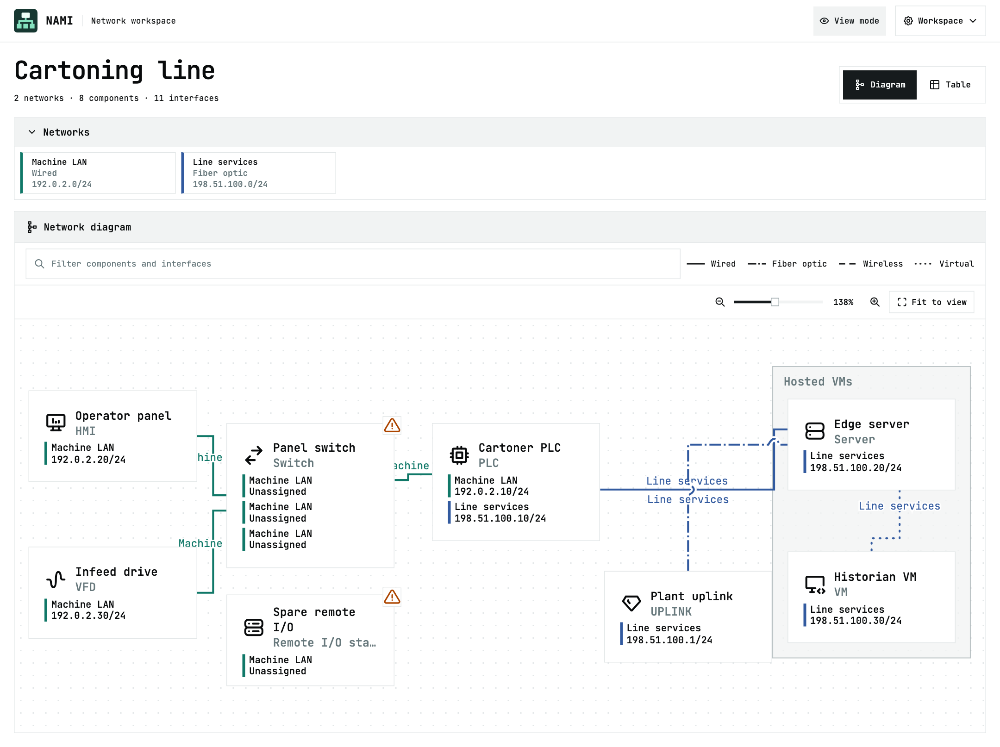
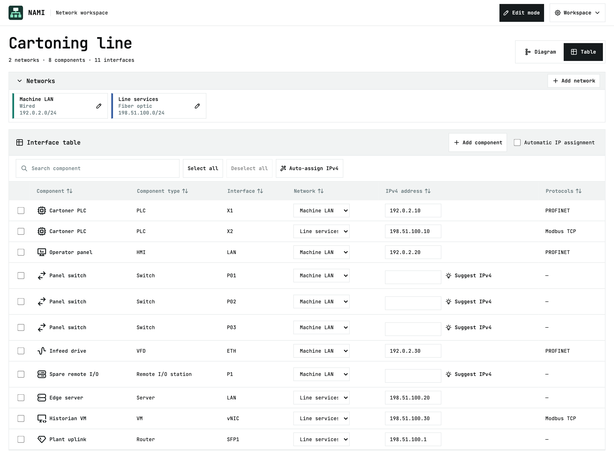
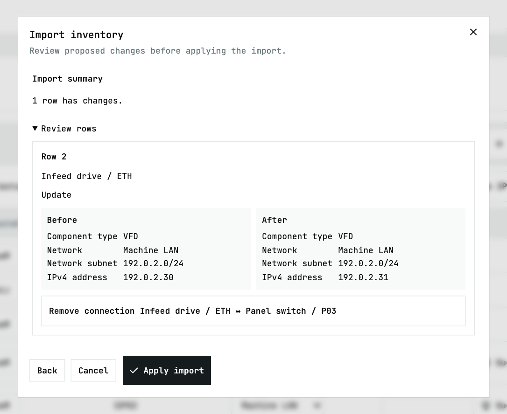

# NAMI

NAMI is a self-hosted web app for planning industrial networks. Draw the connections between PLCs, operator panels, drives, servers, and virtual machines. Review interface inventory, IPv4 addresses, and protocol profiles in a table. Both views use the same plan.

[Quick start](#quick-start) · [Editor password](#set-or-reset-the-editor-password) · [Features](#features) · [User guide](docs/user-guide/README.md) · [Download PDF guide](docs/user-guide/NAMI-User-Guide.pdf) · [Development](#development)



## Quick start

Install Git, the .NET 10 **SDK**, and Node.js 24 with npm. Clone the repository from a terminal.

```sh
git clone https://github.com/okinone89/NAMI.git
cd NAMI
```

| Task | macOS or Linux | Windows PowerShell |
| --- | --- | --- |
| Start local development mode | `./run --dev` | `.\run.ps1 -Dev` |
| Start in production mode | `./run` | `.\run.ps1` |
| Choose and prepare a database | `./run --setup` | `.\run.ps1 -Setup` |

The launcher builds the frontend and serves it with the API. For local production mode, it sets up the HTTPS certificate if needed. Approve the certificate trust prompt if it appears, then open [https://localhost:5080](https://localhost:5080). Development mode opens at [http://127.0.0.1:5080](http://127.0.0.1:5080).

On the first visit, create and confirm a shared editor password to enter Edit mode. Choose **Workspace → New plan** to start. See the [first-plan walkthrough](docs/user-guide/01-get-started.md#build-your-first-plan) for a worked example.

SQLite is the default and saves plans to `src/Nami.Api/data/nami.db`. The interactive setup supports another SQLite file or a PostgreSQL database and saves its settings after migrations succeed. Restart NAMI to use the saved target. For shared hosting, editor configuration, readiness, and backups, see [installation and maintenance](docs/user-guide/06-installation-and-maintenance.md).

### Set or reset the editor password

The first visitor to a database without an editor password creates it in the browser. Use at least 15 characters. NAMI stores a salted hash in SQLite or PostgreSQL so the password works after a restart. Once setup is complete, visitors can browse in **View mode** and use the password to unlock editing. Use HTTPS on shared installations.

To change the password, unlock editing and select **Workspace → Change editor password**. Enter the current password, then enter the new password twice. Other editors will need the new password to unlock editing again.

To reset it, stop NAMI and run the command for your OS from the repository root.

| macOS or Linux | Windows PowerShell |
| --- | --- |
| `./run --reset-editor-password` | `.\run.ps1 -ResetEditorPassword` |

Restart NAMI and open it in a browser to create the new password. [Installation and maintenance](docs/user-guide/06-installation-and-maintenance.md#set-or-reset-the-editor-password)

## Features

- **Draw and edit topology.** Place equipment from the industrial component library, upload a custom icon, or use a labeled shape. Group VMs with their host and distinguish wired, fiber-optic, wireless, and virtual links. Use canvas context actions to connect from a port, duplicate equipment, or edit wiring. Select multiple components to move, update, duplicate, or delete them together. Duplication supports network remapping or fresh IPv4 allocation. [Topology guide](docs/user-guide/02-topology.md)
- **Plan IPv4 and record protocols.** Give each network its own identity, subnet, and color. Check duplicate and out-of-subnet addresses. Use allocation pools and exclusions for individual suggestions, reviewed batch assignment, or automatic assignment during editing. Record PROFINET, EtherNet/IP, and Modbus TCP profiles on interfaces. [IPv4 and protocols guide](docs/user-guide/03-addressing-and-protocols.md)
- **Browse and edit inventory.** Search and filter across both views, sort the interface table, edit addresses inline, and preview bulk network or IPv4 changes before saving. Switch between light and dark themes from the Workspace menu. [Interface inventory guide](docs/user-guide/04-interface-inventory.md)
- **Round-trip inventory and share plans.** Export the full inventory as a timestamped CSV, then upload it or paste spreadsheet rows. Review proposed equipment, address, and wiring changes before applying them. Use conditional undo for the latest import. Transfer a complete plan as JSON or export the diagram and table as a PDF, including selected-network reports and a ZIP with one PDF per named network. [Import, export, and sharing guide](docs/user-guide/05-import-export-and-sharing.md)





## Development

The ASP.NET Core API and persistence code live in [src/Nami.Api](src/Nami.Api). The React and TypeScript workspace lives in [frontend](frontend), with Vite serving the development UI. The [glossary](GLOSSARY.md) defines the terms used in both.

### Run with hot reload

From the repository root, start the API in one terminal. On Windows, use PowerShell.

```powershell
$env:ASPNETCORE_ENVIRONMENT = "Development"
$env:DOTNET_ENVIRONMENT = "Development"
dotnet watch --project src/Nami.Api run --no-launch-profile -- --urls http://127.0.0.1:5080
```

On macOS or Linux, run

```sh
ASPNETCORE_ENVIRONMENT=Development dotnet watch --project src/Nami.Api run --no-launch-profile -- --urls http://127.0.0.1:5080
```

In a second terminal, start Vite and open the URL it prints (normally `http://localhost:5173`). It forwards `/api` and `/health` to the API on port 5080. Set `NAMI_API_ORIGIN` when starting Vite if your API uses another address.

```sh
cd frontend
npm ci
npm run dev
```

On Windows, use `npm.cmd ci` and `npm.cmd run dev` in the second PowerShell window.

### Build and test

From `frontend/`, run the static checks and browser tests. The build typechecks the app and writes the production bundle to `dist/`.

```sh
npm run lint
npm run build
npx playwright install chromium --only-shell
npm test
```

Playwright starts the application with a disposable SQLite database on port 5174 and exercises desktop and phone layouts. Set `NAMI_TEST_WEB_PORT` to use a different port. The [frontend CI workflow](.github/workflows/frontend.yml) runs the build and browser suite on pushes and pull requests.

For the API integration suite, use Python 3 on macOS or Linux and put the PostgreSQL server utilities (`initdb`, `pg_ctl`, and `psql`) on your PATH. Run as a regular user from the repository root. The tests create their own SQLite files and temporary PostgreSQL clusters.

```sh
dotnet build src/Nami.Api
dotnet build tests/PlanPersistence
dotnet build tests/EditorSessionHost
python3 -B -m unittest discover -s tests -p '*.py'
```

<details>
<summary>First-release verification and cross-provider browser tests</summary>

Run the browser suite once for each provider. Start each API with the [database settings in the guide](docs/user-guide/06-installation-and-maintenance.md#configure-a-service-without-prompts), using a fresh SQLite file or empty PostgreSQL database. In a terminal at the repository root, run

```sh
ASPNETCORE_ENVIRONMENT=Development \
  dotnet run --no-build --project src/Nami.Api -- --urls http://127.0.0.1:5081
```

Check that `/health` returns `{"status":"ready"}`, then run the browser suite from another terminal. Playwright starts Vite, proxies requests to the API you started, and creates the editor password for the disposable database.

```sh
(cd frontend && NAMI_TEST_USE_EXTERNAL_API=1 npm test)
```

To verify transfer between providers in Chromium, keep the source API on port 5081. Start a second API on port 5080 with the other provider, its own empty database. In separate terminals, start the destination React app and run the transfer test.

```sh
(cd frontend && NAMI_API_ORIGIN=http://127.0.0.1:5080 npm run dev -- --host 127.0.0.1 --port 5173 --strictPort)
(cd frontend && NAMI_TEST_USE_EXTERNAL_API=1 NAMI_TEST_TRANSFER_DESTINATION=http://127.0.0.1:5173 \
  npm test -- plan-packages.spec.ts)
```

Repeat with fresh databases and the providers reversed. The browser downloads a package from the source, uploads the file through the destination, and reopens the copied plan to check the custom icon, layout, labeled shape, link, and interface data. Keep the disposable databases local.

The first-release run on macOS with .NET SDK 10.0.402, Node.js 24.22.0, and PostgreSQL 18.6 passed these checks.

| Check | Result |
| --- | --- |
| HTTP integration suite | 37 passed, including schema setup and restart, exact eight-hour expiry and editor credential rotation on persisted plans, stale allocation and import, conditional undo, concurrent SQLite saves during a read, and all four transfer directions. |
| Chromium with SQLite | 88 passed, with 12 skips for viewport and input combinations assigned to the other project. |
| Chromium with PostgreSQL | 88 passed, with the same 12 viewport and input skips. |
| Cross-provider transfer in Chromium | 4 passed, covering both provider directions on desktop and phone. |

</details>
