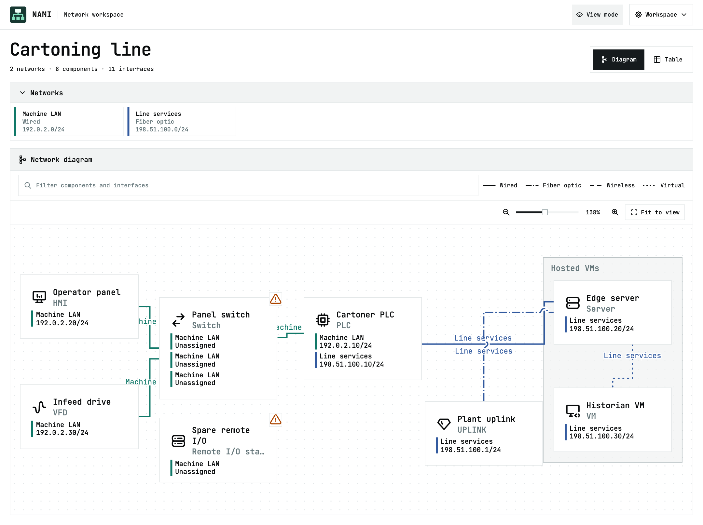
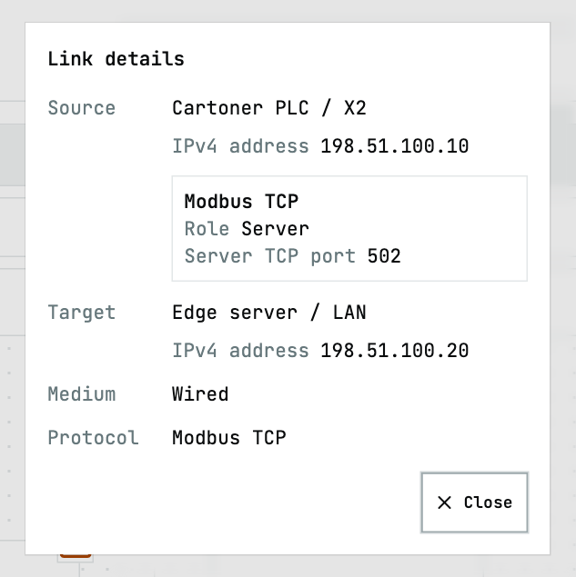
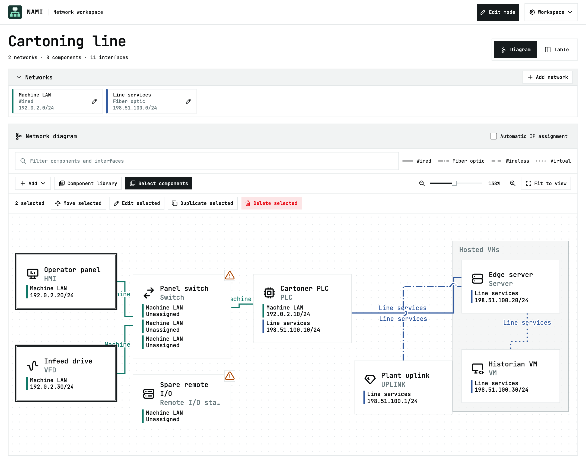

# 2. Draw and edit topology

## Find and place equipment

- **Browse the canvas.** Drag empty space to pan with a pointer. On touch screens, scroll the canvas with a swipe. Use the zoom slider or the zoom buttons, click the percentage to reset to 100%, and use **Fit to view** to frame the visible equipment. Refit after applying a network filter.
- **Find an item.** Search by component name or type, interface name, network name, or IPv4 address. Diagram search lists matches across the plan. Choose a result to reveal and highlight its component, including one outside the current network focus.
- **Add a component.** Choose **Add → Add component**, or open **Component library** and choose an industrial symbol. With a pointer, drag **Add** or a library symbol onto the canvas to set its position before editing its details. The library includes controllers, switches, servers, VMs, drives, remote I/O, IO-Link equipment, and instrumentation such as vision cameras and barcode readers.
- **Edit a component.** Open it to change its name, type, representation, or interfaces. **Representation** can follow the type, use a different built-in symbol, use a custom PNG, JPEG, or WebP icon up to 96 KiB, or display a labeled rectangle, ellipse, or diamond. The shape label can be up to 48 characters.
- **Move equipment.** Drag a component, or open it and choose **Move**. Click or tap the destination. For keyboard placement, use the arrow keys on the focused canvas and press Enter to save, or Escape to cancel. Moving a host moves its enclosed guests with it.
- **Group VMs.** Edit a component of type **VM** and choose its server in **Hosted on**. The diagram encloses it with the host. Open the server to inspect or edit its guests. A VM keeps its interfaces and identity when you switch hosts or choose **No host**. Hosting and a documented virtual link are separate plan fields.

## Draw and inspect connections

1. Choose **Add → Add link** for a general connection. Set the source and target components and choose their interfaces if known. Use **Port unspecified** for a component-only endpoint you can refine later.
2. Set **Medium** to **Wired**, **Fiber optic**, **Wireless**, or **Virtual**. Enter an optional link protocol and select **Save link**. The diagram routes links around equipment and draws jumps at crossings. Parallel links can connect the same endpoints.
3. Activate a link to open **Link details** and inspect the endpoint interfaces, addresses, and protocol profiles. Editors can change the link here or use **Edit link** and **Remove link** from its context menu. Removing a link leaves its endpoint components and interfaces in the plan.

To connect two specific interfaces and put both on the same network, open a component’s context menu and choose **Link from** followed by the port name. Select the other component and its interface in **Connect interface**. In the component editor, use **Add link from** on a saved interface to start the same workflow. Pick an existing network or **Create network…**, then review any network moves. Adjust the affected IPv4 addresses if needed and choose **Accept change and link**. If no network moves are needed, choose **Create link**. Finish the network's subnet, color, or allocation settings in **Edit network**.

With a pointer, right-click a component or link for its context actions. With a keyboard, focus it and press Shift+F10 or the Context Menu key.

## Work with a selection

Choose **Select components** and pick individual components, or drag a selection rectangle over them with a pointer. Shift-click toggles a component and Shift-drag on empty canvas adds components to the selection. On touch screens, turn on selection mode and tap individual components. Use the selection toolbar or the context menu of a selected component.

- **Move selected** places the group while preserving its arrangement. You can also drag a selected component to move the group.
- **Edit selected** applies a common component type, representation, or both. Check the fields to change and choose **Save changes**.
- **Duplicate selected** makes copies with unique names, preserving their interfaces, profiles, and links between selected components. Links to devices outside the selection stay with the originals. Include both host and guest to point the copied guest at the copied host. You can also choose **Duplicate** on a single component.
- **Delete selected** asks for confirmation and removes the selected components, their interfaces, and connected links. A guest you leave behind becomes unhosted if you delete its host.

With **Automatic IP assignment** off, duplicating components with interfaces opens a dialog. Choose a destination for each group of interfaces, keeping the current network, selecting another existing network, or creating a new one. Copies retain their source addresses, so review any conflicts before saving. With automatic assignment on, copies stay on the source networks and NAMI assigns fresh addresses where possible. If a pool runs out, affected copies save with blank addresses. Clear active filters if the new copies are hidden.
