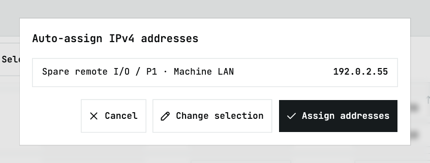

# 3. Plan IPv4 addresses and protocol profiles

## Define a network and set membership

Choose **Add network** or use the pencil on an existing network tile. Give each network a distinct name in the plan. To define its subnet, enter the IPv4 network address and dotted-decimal mask. To leave the subnet unspecified, leave both fields blank. You can also choose a network type and color, then select **Save network**.

Network membership is set per interface. A PLC with two ports can belong to two networks through those ports. An interface can have no network or no IPv4 address while you gather details. A switch port can record membership and wiring with its address left blank. A link in **Add link** documents wiring independently of membership. **Connect interface** can update both.

## Configure allocation

Open **Allocation pool and exclusions** while editing a network with a subnet. Leave **Pool start** and **Pool end** blank to use the subnet’s usable host addresses, or enter both ends to limit the pool. Enter excluded addresses and address ranges one per line, using a hyphen between the first and last address. Allocation skips existing assignments and exclusions.

For example, set the **Machine LAN** pool to `192.0.2.50` through `192.0.2.79`, and enter `192.0.2.50 - 192.0.2.54` as an exclusion. The first available address is `192.0.2.55` if it has no assignment.

- **Suggest one address.** In the component editor, use **Suggest IPv4** next to a blank IPv4 field whose network has a subnet. Accept the suggestion and save the component to commit it. In **Table**, **Suggest IPv4** on an eligible saved row previews an address. **Accept suggestion** applies it directly.
- **Assign a batch.** In **Table**, choose **Auto-assign IPv4**, select the blank interfaces you want to fill, and choose **Preview assignment**. Review addresses and availability, then select **Assign addresses**. If another edit changes the proposal, review the refreshed preview before confirming again.
- **Allocate during editing.** Turn on **Automatic IP assignment** in the view header to enable automatic allocation when saving blank eligible interfaces through component or interface edits, bulk editing, and duplication. The setting is shared between views and remembered in this browser. Existing addresses remain unless the workflow changes them. If the pool cannot fill every interface, check the preview or save notice for blank addresses.

## Resolve address issues

NAMI validates address syntax, checks that assigned addresses fall within the subnet when one is defined, and checks for duplicate addresses within each named network. Isolated networks can use the same subnet and addresses. For a duplicate you need to document, choose **Keep conflict flagged** when the workflow offers it. The diagram and table keep a visible warning until the conflict is corrected. Fix invalid or out-of-range values by editing the address, membership, or subnet as appropriate.

## Record interface protocols

Open a component from either view. In **Interfaces**, choose **Add protocol profile**, choose the protocol, fill in its planning fields, and save the component. Repeat for additional profiles. Profiles on the same interface share its address and network assignment.

| Profile | Fields you can record |
| --- | --- |
| **EtherNet/IP** | Device class such as **Scanner**, **Adapter**, or **Messaging**. |
| **PROFINET** | Station name and one or more roles such as **IO controller**, **IO device**, or **IO supervisor**. |
| **Modbus TCP** | **Client** or **Server** role, server port when applicable, and downstream devices with names and Unit IDs. |

The interface table summarizes profile names. Open the component or a connected link to see the full settings, including any downstream devices. The optional protocol label on a link describes that connection independently of the profiles at its endpoints.
