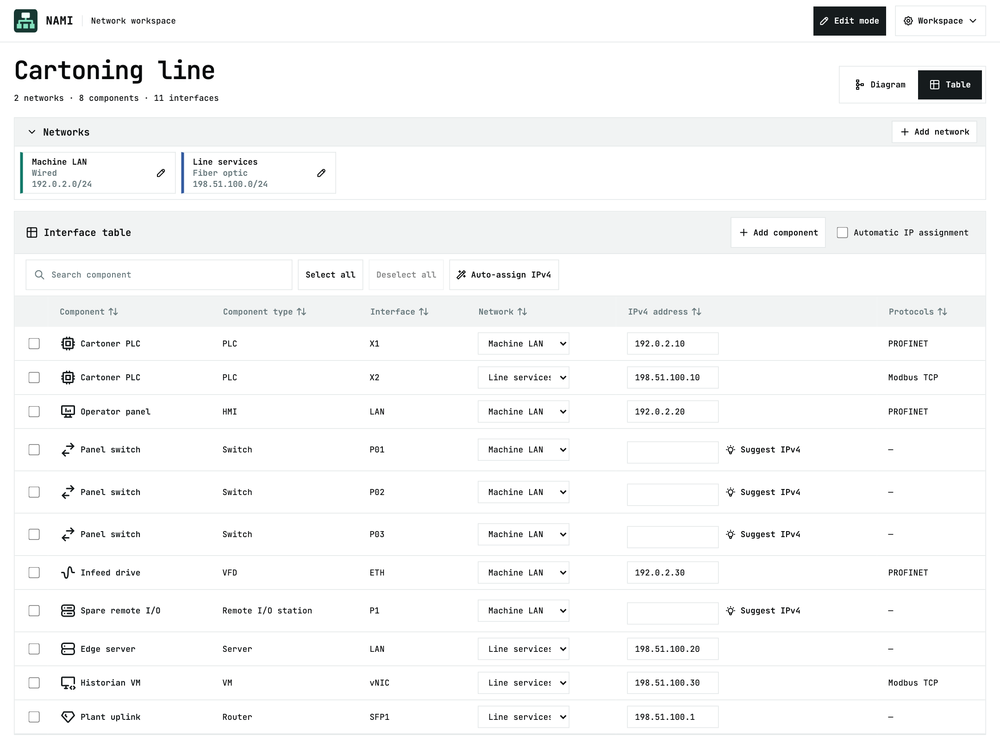
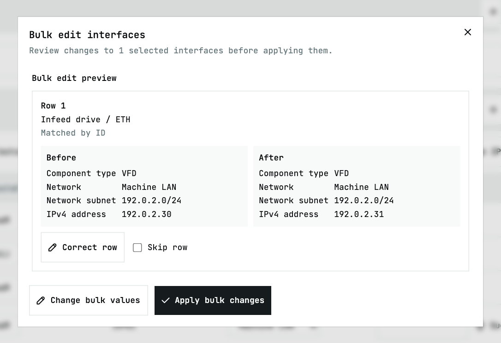

# 4. Browse and edit interface inventory

## Find and inspect interfaces

1. Choose **Table**. Each interface has its own row. Components with no interfaces appear in a separate section when no network is selected.
2. Select network tiles to narrow the list. The **Search component** field also matches component type, interface name, network name, IPv4 address, and protocol names. Network and text filters carry between **Table** and **Diagram**.
3. Select a column heading to sort and select it again to reverse the order. The table sorts IPv4 addresses numerically. On a narrow screen, scroll horizontally to reach the other columns.
4. Open the component name to inspect its interfaces and protocol details. In edit mode, use that editor to add or rename an interface, change protocols, or change the component. Choose **Add component** in the table header to create a new device from this view.

## Edit one row

In **Edit mode**, change the network selector or IPv4 field in a row. The toolbar shows the component and interface you are editing, even if a filter hides the row. Choose **Save interface** to commit or **Discard changes** to close the draft. Select **No network** to clear membership. Empty the IPv4 field to clear its address. Check the result if **Automatic IP assignment** is on, since an eligible blank address may be filled again.

## Review and apply bulk changes

1. Filter to the rows you need and check them individually, or choose **Select all** to replace the selection with the visible rows. Individual selections can persist when filters hide them. **Deselect all** clears the visible rows. Check the selection count before opening the bulk editor.
2. Choose **Edit selected interfaces**. Keep the current network, choose a different one, or explicitly clear membership. Keep current addresses, enter an address, or choose **Clear IPv4 addresses**. For unique assignments across several blank ports, see [allocation](03-addressing-and-protocols.md#configure-allocation).
3. Choose **Preview changes** and review the before and after values for each affected row. Use **Correct row** or **Skip row** and **Update preview** as needed. Use **Keep conflict flagged** for a duplicate you intend to document.
4. Select **Apply bulk changes** when the preview reflects your intended update. If the plan changes while you review, inspect the refreshed preview and apply again. **Undo import** is reserved for the latest inventory import.

