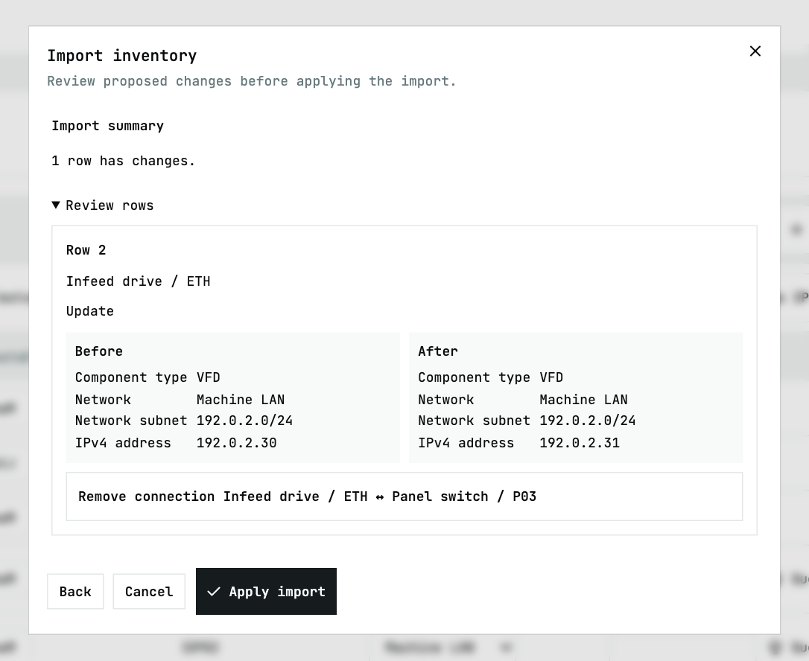
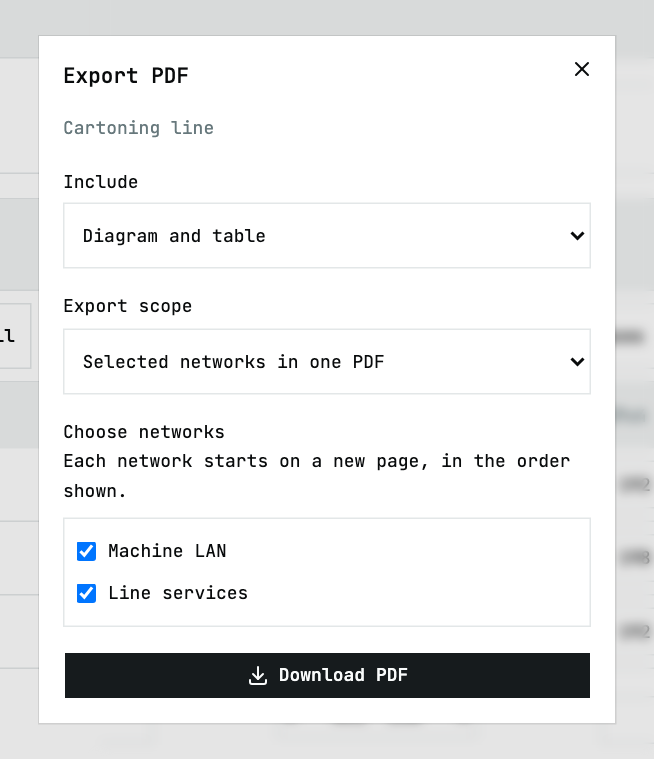

# 5. Import, export, and share plans

| Use | Workspace action | Access |
| --- | --- | --- |
| Edit inventory or cabling in a spreadsheet | **Export → Inventory CSV** and **Import → Inventory CSV** | Export in either mode. Import in **Edit mode**. |
| Transfer an independent copy of a complete plan | **Export → Plan package** and **Import → Plan package** | **Edit mode**. |
| Share a readable drawing or address list | **Export → PDF** | Either mode. |

**Workspace → Import/export help** provides a quick reference in either view.

## Work with the inventory CSV

Choose **Workspace → Export → Inventory CSV** to download the entire open plan’s inventory. The timestamped file includes interfaces, components without interfaces, component-only connections, and networks without assigned ports. A port may appear on several rows for its different links. A link can appear from both ends.

Keep all ten headers. You can reorder the columns. Start with a fresh export if an older template includes internal IDs.

```csv
Component,Interface,Component type,Network,Network subnet,IPv4,Link partner,Partner port,Connection type,Link protocol
Cartoner PLC,X1,PLC,Machine LAN,192.0.2.0/24,192.0.2.10,Panel switch,P01,Wired,PROFINET
Panel switch,P01,Switch,Machine LAN,192.0.2.0/24,,Cartoner PLC,X1,Wired,PROFINET
```

- **Identity and additions.** Names match without regard to case. Component and network names are scoped to the plan, and interface names to their component. New rows can add components, interfaces, or networks. Supply **Component type** for new equipment. To change an existing component’s type, use its editor. Leave **Interface** blank for a component-level row, or leave both **Component** and **Interface** blank for a network-only row.
- **Blank cells.** Empty cells on matched rows preserve existing values and connections. Use the wizard’s explicit clear or remove controls when available, or edit the relevant interface or link in the workspace. Omit rows you do not want to update. A network subnet uses CIDR, such as `192.0.2.0/24`.
- **Cabling.** Enter a link partner and optional partner port. A blank partner port connects to the component itself. Declare new endpoint equipment in the same sheet or refer to equipment already in the plan. For a new connection, supply **Wired**, **FO** (fiber optic), **Wireless**, or **Virtual** in **Connection type**. **Link protocol** is optional and describes the connection. Matching declarations from both ends represent the same link. Review any proposed parallel links or changes to existing wiring.
- **Scope.** CSV carries inventory and link fields. Use a JSON package for layout, hosting, network colors and allocation settings, custom symbols, or detailed interface protocol profiles.

## Preview, decide, and apply

1. Open the destination plan and choose **Workspace → Import → Inventory CSV**. Select a **CSV file**, or paste spreadsheet rows including the headers and choose **Load pasted rows**. Choose **Preview import**.
2. Clean changes go straight to **Import summary**. If the wizard asks for decisions, review related rows and choose the intended interpretation. For example, an unfamiliar name could mean new equipment or a rename. A changed partner could mean adding a connection or changing an installed one. Use **Correct values**, **Skip affected rows**, or **Skip connection** as appropriate. You can keep an address conflict flagged when offered. Choose **Next**, or use **Back** to revisit a decision.
3. In **Import summary**, expand **Connection changes** and **Review rows** where shown. Compare the before and after values and review skipped rows or connections. Use **Remove connection** on an installed link only when you intend to remove it. Choose **Apply import** to commit or **Cancel** to leave the plan as it is. A **No changes** result can be closed.
4. If the plan changes during review, review the refreshed preview and resolve any new decisions before applying again.
5. To reverse the latest import, switch to **Table** in edit mode and use **Undo import** if available. Undo preserves unrelated edits. It can become unavailable if affected records changed, a later edit depends on imported equipment, or restoring previous values conflicts with the current plan.



## Transfer a complete plan

1. In the source workspace, unlock editing, open the plan, and choose **Workspace → Export → Plan package** to download its JSON package.
2. In the destination workspace, unlock editing and choose **Workspace → Import → Plan package**. Choose the `.nami.json` file under **Plan package**, then select **Import plan**.
3. NAMI opens an independent copy, even if the name is already present. Review the destination’s equipment, interfaces and profiles, networks, links, layout, and VM hosting. Use **Workspace → Edit plan** to give the copy a distinct name.

This works across SQLite and PostgreSQL installations. To protect every plan in an installation, use a [database backup](06-installation-and-maintenance.md#back-up-and-restore).

## Create a handoff report

Choose **Workspace → Export → PDF**. Set **Include** to **Diagram**, **Table**, or **Diagram and table**, then select a scope.

- **Current filters** uses the plan’s current network and search filters.
- **Whole plan** includes unassigned inventory.
- **Individual network** offers each named network as a separate choice.
- **Selected networks in one PDF** starts each chosen network on a fresh page in the order shown. The selection is remembered for the plan in this browser.
- **One PDF per network (ZIP)** produces an archive with one PDF for each named network.

Select **Download PDF** or **Download ZIP**. Open the downloaded report to check its scope before sharing.


